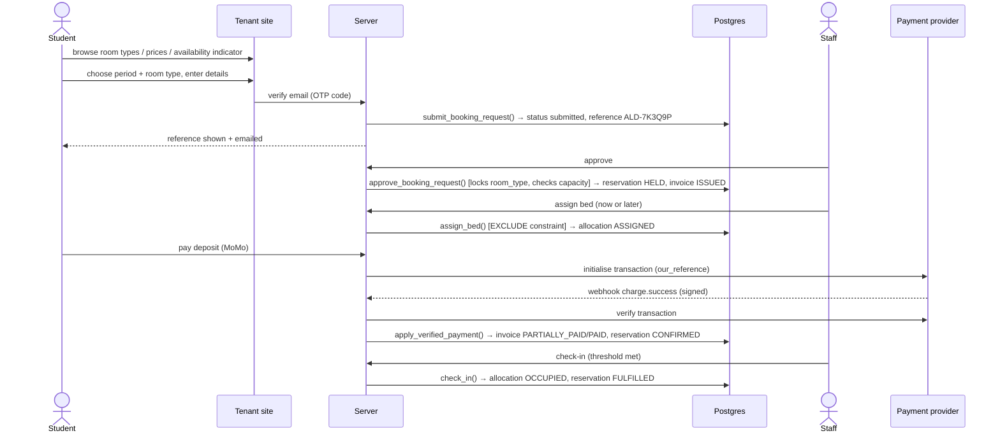
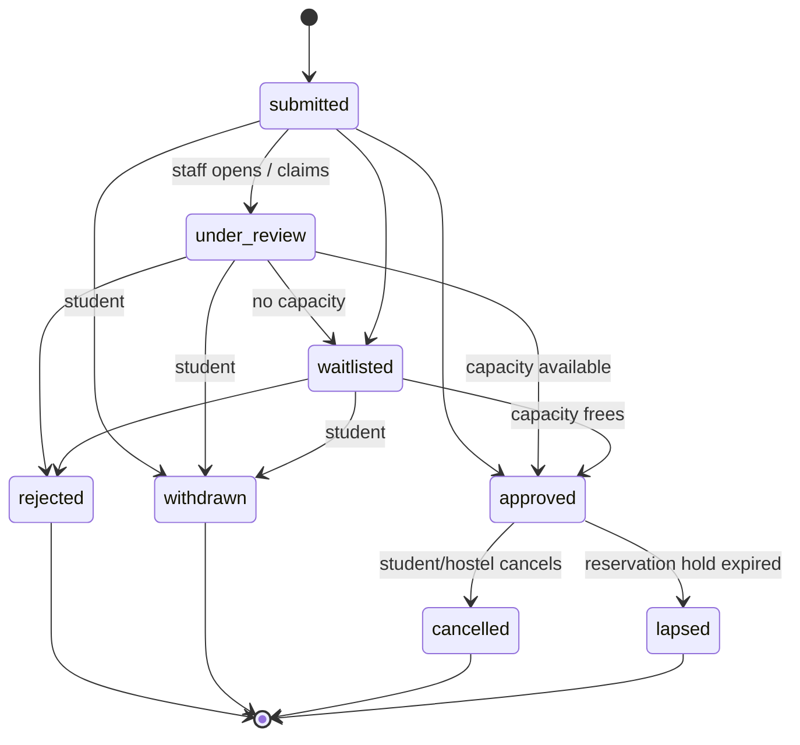
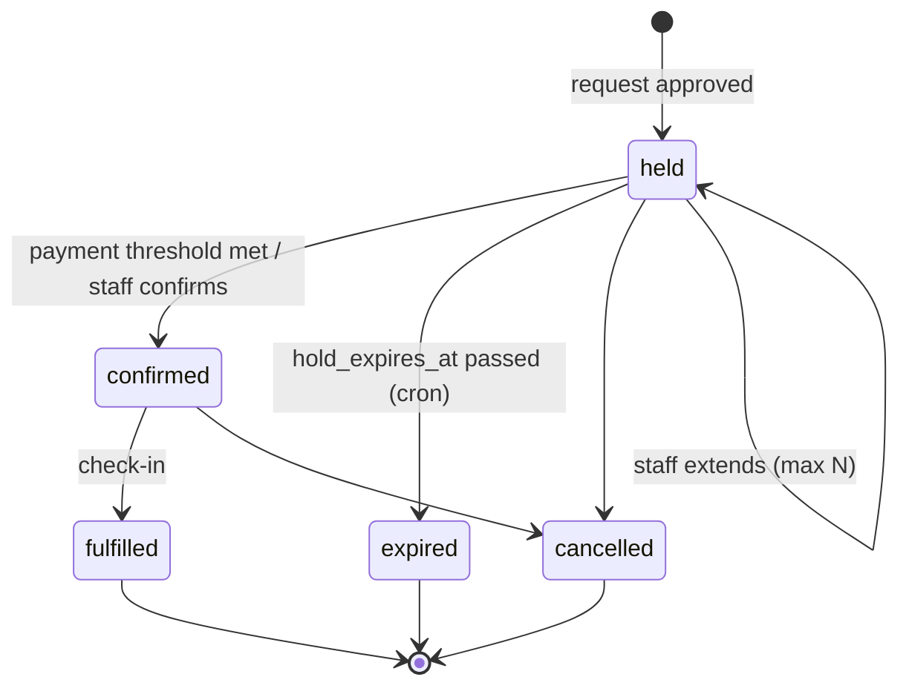
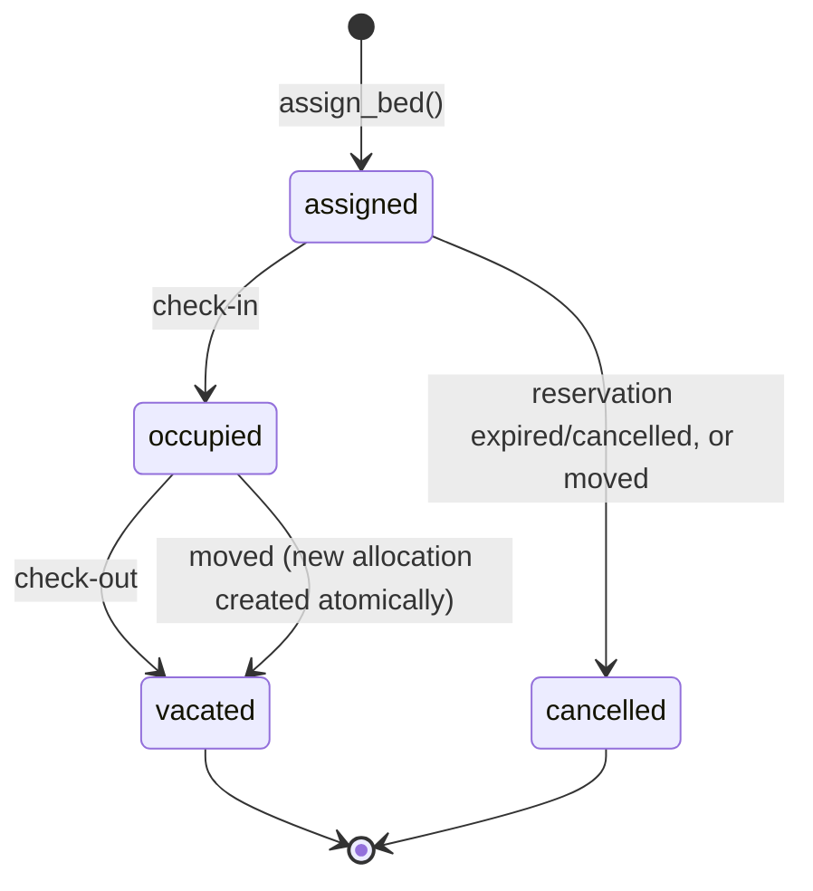
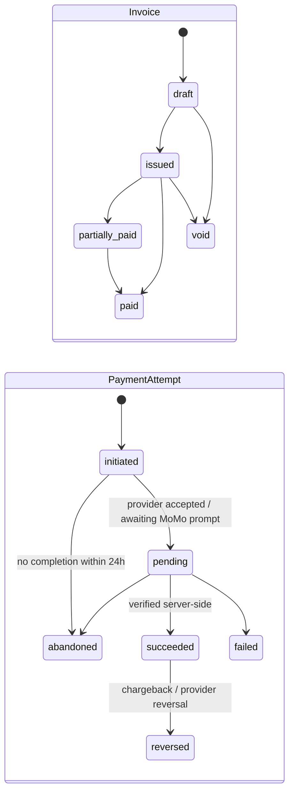

# Booking and Payment Flows

> Status: Phase 0 draft. The approved MVP workflow (brief §5) is the source of truth. Items marked **[D-n]** need product-owner approval. See [ADR-0003](adr/0003-booking-concurrency.md) and [ADR-0004](adr/0004-payment-processing.md).

## 1. End-to-end flow

## 2. State machines

Five separate state machines, as the brief requires. The student-facing "timeline" is *derived* from them and is not stored.

### 2.1 Booking request status

| Transition | Who | Guard | Side effects |
|---|---|---|---|
| → submitted | Resident (verified email) or staff `bookings.create_on_behalf` | Period open; room type published; no live request for the same period; price exists | Reference generated; price snapshot; email |
| → approved | `bookings.review` | Capacity check (§3) inside a lock | Reservation `held`; invoice issued per payment policy; notification |
| → rejected | `bookings.review` | Reason required | Notification |
| → waitlisted | `bookings.review` | — | Notification with position (optional) |
| → withdrawn | Owner | Not yet approved | — |
| → cancelled | Owner (per policy) or `bookings.cancel` | Reason required | Reservation `cancelled`, allocation `cancelled`, refund evaluation (§5.9) |
| → lapsed | System (cron) | Reservation expired | Allocation cancelled, unpaid invoice voided |

**Booking window closing (product owner, 2026-11-22):** requests are not expired automatically when `booking_closes_at` passes. Closing the window stops new submissions; unreviewed and waitlisted requests stay in the staff queue until staff approve, waitlist or reject them. The `expired` value remains allowed in the status column but no workflow sets it.

### 2.2 Reservation (inventory hold) status

### 2.3 Bed allocation status

### 2.4 Invoice status and payment-attempt status

*Overdue* is a computed flag (`due_on < today` and a balance remains), not a status, so it cannot drift.

### 2.5 Stay (check-in/out) status

This is derived from the allocation plus `check_events`: `awaiting_arrival` → `checked_in` → `checked_out`, or `no_show`.
- **Check-in guard:** the allocation is `assigned`, the reservation is `confirmed`, `paid_percent ≥ tenant_settings.min_paid_percent_for_checkin` (unless overridden with a reason by `hostel_admin`), and ID has been sighted (checklist).
- **No-show:** marked by staff after N days past the period start [D-5]. The allocation is cancelled and the reservation follows the cancellation policy.

## 3. Recommended reservation-expiry and bed-hold rules **(approval required: D-3, D-4)**

| Rule | Recommendation | Rationale |
|---|---|---|
| Hold at submission? | **No.** Submissions never consume inventory. | Requests may far exceed supply at admission time. Holding on submit lets spam or indecisive applicants block real students. |
| When is inventory held? | **On approval**, at room-type level (`reservations.held`). | Matches the approved workflow. Staff control who gets capacity. |
| Capacity rule | Live reservations (`held` + `confirmed` + `fulfilled`) for room type × period must be at most the sellable beds of that type for that period. | Guarantees every approved student can receive a bed. |
| Hold duration | **5 days (120 h)** from approval by default; tenant-configurable between 24 h and 14 days. | Parents often fund rent; MoMo is fast, but gathering funds is not. |
| Extensions | Staff may extend **once** (configurable) by up to the default duration, with a reason. | Flexibility without indefinite blocking. |
| Reminders | 48 h and 12 h before expiry (email; SMS once D-10 is decided). | Reduces lapses. |
| Confirmation threshold | Deposit paid in full (default). Options: full payment, or staff manual confirmation. | Deposit is the common Ghanaian practice; configurable. |
| Expiry action | Reservation `expired`, allocation `cancelled`, request `lapsed`, unpaid invoice `void`, waitlist notified. | Frees capacity deterministically. |
| Bed assignment timing | Allowed once approved (`held`), so staff can plan rooms early. Setting `require_payment_before_allocation` can restrict it to `confirmed`. | Matches the workflow ("when approved, assign a bed") while allowing stricter hostels. |
| Overbooking | Not allowed in v1. | Simplicity and trust. |
| Availability shown publicly | Indicator only: *Available* / *Limited* (≤ 3 left) / *Fully booked: join waitlist*. Exact counts are hidden [D-4]. | Avoids gaming and reveals less to competitors. |

## 4. Transaction boundaries (Postgres RPCs)

Each step below is **one** database transaction inside a `SECURITY DEFINER` function. It checks the permission, takes row locks in a fixed order (tenant-level rows → room_type → bed → reservation → invoice → payment) to avoid deadlocks, and writes `audit_logs` in the same transaction.

| RPC | Locks | Key checks |
|---|---|---|
| `submit_booking_request(period, room_type, note, idem_key)` | none (unique constraints) | Period open, room type published, resident verified, rate limit |
| `approve_booking_request(id)` | `booking_requests` row, then `room_types` row `FOR UPDATE` | Status in (submitted, under_review, waitlisted); capacity rule |
| `reject_ / waitlist_ / cancel_booking_request(id, reason)` | request, reservation, allocation | Transition validity |
| `extend_hold(reservation_id, hours, reason)` | reservation | `extensions_used < max` |
| `assign_bed(reservation_id, bed_id)` | reservation, bed `FOR UPDATE` | Bed active, same room type (or explicit override with reason), gender policy, no overlapping block; **EXCLUDE constraint is the final guard** |
| `move_bed(allocation_id, new_bed_id, reason)` | allocation, both beds (ordered by id) | Old allocation ends and new one inserted atomically |
| `block_bed(bed_id, range, reason)` | bed | Refuses if it overlaps an `assigned/occupied` allocation (staff must move the resident first); warns if this makes the room type overcommitted |
| `issue_invoice(...)` / `void_invoice(id, reason)` | invoice, `tenant_counters` | Only from draft/issued; void only with no successful payments |
| `create_payment_attempt(invoice_id, amount)` | invoice | Amount ≤ balance; invoice issued; creates `our_reference` |
| `apply_verified_payment(payment_id, verified jsonb)` | payment, invoice, reservation | Idempotent; amount/currency/reference match (§5) |
| `record_manual_payment(invoice_id, amount, method, evidence)` | invoice | Permission; evidence required above a threshold [D-15] |
| `check_in(allocation_id, checklist)` / `check_out(...)` | allocation, reservation | Guards from §2.5 |
| `expire_reservations()` (cron) | each due reservation, `SKIP LOCKED` | `status = held and hold_expires_at < now()` |

## 5. Integrity scenarios

| # | Scenario | Handling |
|---|---|---|
| 1 | **Two students request the final available bed** | Both *submissions* succeed (no hold on submit). When staff approve, `approve_booking_request` locks the `room_types` row, so concurrent approvals serialise. The second approval sees capacity 0 and fails with "no capacity"; staff can waitlist that request. |
| 2 | **Staff assign the same bed to two students** | `assign_bed` locks the bed row, so the second transaction waits, then re-checks. Even if that logic had a bug, the `EXCLUDE USING gist (bed_id WITH =, stay WITH &&)` constraint rejects the overlapping insert (SQLSTATE `23P01`). The UI shows "bed was just assigned, refresh". |
| 3 | **Approved but payment pending** | Reservation stays `held` until the deposit threshold is met or the hold expires. The allocation may exist (`assigned`) but check-in is blocked by its guard. The student portal shows "Pay deposit by <date>". |
| 4 | **Same webhook delivered multiple times** | Insert into `private.payment_events` with unique `(provider, dedupe_key)`. Duplicates hit `ON CONFLICT DO NOTHING` and return 200. `apply_verified_payment` is idempotent: if the payment is already `succeeded`, it does nothing. |
| 5 | **Payment succeeds but the browser closes** | The browser plays no part in confirmation. The webhook (or, for Hubtel, the callback or a mandatory status check after 5 minutes), plus the reconciliation cron (§6) for `pending/initiated` payments older than 15 minutes, confirm the payment. The student sees "Paid" on next visit and gets an email receipt. |
| 6 | **Delayed or out-of-order events** | Events never drive state directly. Each event triggers a **verify API call**, and the verified provider status is applied through monotonic transitions only. `succeeded` cannot go back to `pending`; `reversed` is allowed only from `succeeded`. Old events after a newer state are recorded as `ignored`. |
| 7 | **Reservation expires before payment completes** | The expiry cron skips reservations with a `pending` payment attempt younger than 30 minutes (grace period). If payment succeeds after expiry, the money is still applied to the invoice. The system then tries to **re-instate** the reservation under the room-type lock: if capacity exists, the reservation goes back to `confirmed` and staff are notified to re-assign a bed. If there is no capacity, the payment is flagged `needs_review` for staff to choose between waitlist and refund. A paid student is never silently dropped. |
| 8 | **Amount or currency mismatch** | `apply_verified_payment` compares the verified amount and currency with the payment attempt. A **currency** mismatch is never applied; it is flagged `needs_review` and alerted. An **underpayment** is applied as the actual verified amount, the invoice becomes `partially_paid`, and the threshold may not be met. An **overpayment** is applied up to the balance and the excess is recorded as credit and flagged for refund or credit decision. The reference must match `our_reference`; a metadata `tenant_id` that differs from the endpoint's tenant is rejected and alerted. |
| 9 | **Booking cancelled after payment** | `cancel_booking_request` releases the reservation and allocation, then creates a refund *evaluation* using the tenant's cancellation policy [D-7] (e.g. full refund within 48 h of payment, deposit retained after X). The refund goes through `refunds` (requested → approved by a different user → processed). v1 refunds are executed in the provider dashboard or manually, and the reference is recorded. |
| 10 | **Bed becomes unavailable (maintenance)** | `block_bed` refuses if the bed has a live allocation in the range, so staff must `move_bed` the resident first (atomic). Blocks reduce sellable capacity, so new approvals respect it. If blocks push live reservations above capacity, the dashboard shows an **overcommitted** alert listing affected reservations. Existing reservations are never auto-cancelled. |
| 11 | Student submits the form twice (double click / retry) | The client sends an `idempotency_key` per form render; unique `(tenant_id, resident_id, idempotency_key)` returns the existing reference. |
| 12 | Webhook for unknown or other tenant | The endpoint URL contains the random `webhook_endpoint_id`, which resolves the tenant and secret. Signature is checked with that tenant's secret, the verify call is made with that tenant's key, and the reference must belong to that tenant. Anything else is stored with `processing_status = ignored` and alerted. |

## 6. Payment verification and reconciliation

1. **Initiation (server):** create `payments(initiated)` with `our_reference = <prefix>-<base32>` (≤ 32 chars). Call the provider with the amount in pesewas, currency GHS, reference, callback URL, and metadata `{tenant_id, payment_id}`. The browser receives only the checkout URL/access code.
2. **Return/callback page:** shows "Confirming your payment…" and calls a server action that **runs verify** and displays the result. Query-string parameters are never trusted.
3. **Webhook:**
   1. Read the **raw body**.
   2. Verify the signature in constant time. Paystack uses HMAC-SHA512 with the tenant's secret key in the `x-paystack-signature` header (confirm against current docs during Phase 5).
   3. Insert the event into the inbox.
   4. Respond 200 quickly.
   5. Process the event: verify via the provider API, then apply.
4. **Reconciliation cron:**
   - **Every 15 minutes:** run verify on `initiated/pending` payments older than 10 minutes.
   - **Nightly:** list provider transactions for the last 72 h and match them with `payments` by reference. Unmatched provider successes become alerts; local successes without a provider record become alerts.
   - **Daily:** totals report per tenant (provider settled vs recorded).
5. **Retry:** failed event processing is retried with exponential backoff up to 8 times, then marked `failed` and alerted. Provider API timeouts never mark a payment failed; it stays `pending` for the next sweep.
6. **Manual/offline payments:** recorded by `finance.record_payment` with method, date, payer phone/last 4 digits, and an evidence upload. Optional four-eyes approval above a threshold [D-15].
7. **What "payment integration complete" means:** a Phase 5 acceptance criterion, not "a checkout button exists". It requires test-mode end-to-end runs for the success, failure, abandonment, duplicate webhook, delayed webhook, mismatch and reconciliation paths.

## 7. Audit requirements
Every transition in §2 writes `audit_logs` with the actor, the before/after status, the reason (mandatory for reject/cancel/extend/move/void/override/refund), and the request id. Webhook-driven changes record `actor_type = 'webhook'` and the `payment_events.id`.
