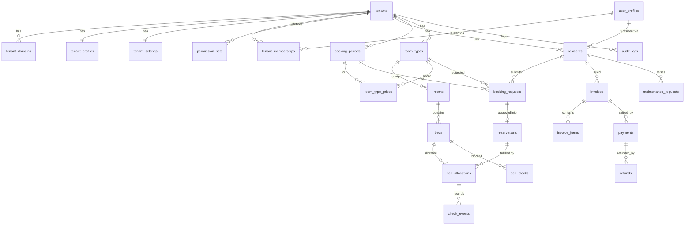

# Database Design (preliminary)

> Status: Phase 1 in progress. Tenancy, people/access, audit and rate-limit tables are implemented in `supabase/migrations/` (task 3); not yet applied to the hosted project. Column lists are design intent; the exact DDL is written and reviewed in the phase that introduces each table.

## 1. Conventions

| Topic | Convention |
|---|---|
| Naming | `snake_case`, plural table names, singular column names; FK columns `<entity>_id` |
| Primary keys | `uuid` with `default gen_random_uuid()`; `audit_logs` uses `bigint generated always as identity` |
| Tenant column | `tenant_id uuid not null` on **every** tenant-owned table, always the first FK |
| Composite key for isolation | Every tenant-owned table has `unique (tenant_id, id)`. Child tables reference parents with **composite FKs** `(tenant_id, parent_id) → parent(tenant_id, id)`. This makes cross-tenant links impossible at the database level. |
| Timestamps | `created_at timestamptz not null default now()`, `updated_at` maintained by trigger; domain timestamps such as `approved_at` are explicit |
| Dates | Stay dates use `date` / `daterange` (hostel stays are whole days). Africa/Accra is UTC+0, which removes DST issues. |
| Status fields | `text` + `CHECK (status in (...))`, chosen over Postgres enums because they are easier to evolve in migrations. Transitions are enforced in RPC functions, not by ad-hoc updates. |
| Money | `bigint` **minor units (pesewas)** in `*_minor` columns, plus `currency char(3) not null default 'GHS' check (currency = 'GHS')`. No floats. |
| Phone | `text` in E.164, `CHECK (phone ~ '^\+[1-9][0-9]{7,14}$')`; normalised server-side |
| Email | `citext` |
| Human references | Non-sequential, unguessable: `<TENANT_PREFIX>-<6 chars Crockford base32>`, e.g. `ALD-7K3Q9P`. Invoice and receipt numbers are sequential per tenant (accounting expectation) but are never used alone for lookup. |
| Soft delete | Not used generically. Business records move to terminal statuses (`cancelled`, `retired`, `void`). Hard deletes only for drafts and under the data-retention policy. |
| Schemas | `public`: tables exposed through PostgREST, all with RLS. `app`: helper functions (not exposed). `private`: secrets, rate-limit buckets and raw webhook payloads (not exposed, no anon/authenticated grants). |
| Migrations | Supabase CLI, `supabase/migrations/<timestamp>_<verb>_<object>.sql`, forward-only. Every migration that adds a tenant table must add RLS + policies + a pgTAP isolation test in the same PR. Destructive migrations need explicit approval. |
| Extensions | `pgcrypto`, `citext`, `btree_gist` (bed-overlap exclusion). |

## 2. Entity-relationship overview



## 3. Authorization helper functions (schema `app`)

All are `STABLE`, `SECURITY DEFINER`, `set search_path = ''`, and use `(select auth.uid())` so Postgres caches the value per statement.

| Function | Returns true when |
|---|---|
| `app.is_platform_admin()` | the caller is in `platform_admins` **and** the JWT has `aal = 'aal2'` (MFA) |
| `app.tenant_is_active(tid)` | `tenants.status = 'active'` |
| `app.is_tenant_member(tid)` | an active `tenant_memberships` row exists for the caller **and** the tenant is active **and** the session meets the MFA policy (`app.caller_meets_mfa_policy()`: accounts that are hostel or platform admins need aal2) |
| `app.has_permission(tid, perm text)` | member with role `hostel_admin`, **or** whose permission set contains `perm`, subject to the same MFA policy |
| `app.my_resident_id(tid)` | returns `residents.id` for the caller in that tenant (or null) |
| `app.has_break_glass(tid)` | an unexpired, unrevoked `platform_access_grants` row exists for the caller |

The policy pattern for a tenant-owned table `x`:

```sql
-- staff read
create policy x_staff_select on public.x for select to authenticated
  using (app.has_permission(tenant_id, 'x.read') or app.has_break_glass(tenant_id));
-- writes go through RPCs; direct insert/update/delete policies are omitted
-- unless the operation is a simple single-row edit.
```

Default stance: **no INSERT/UPDATE/DELETE policies** on workflow tables (bookings, reservations, allocations, invoices, payments). All writes go through `SECURITY DEFINER` RPCs that:
1. check `app.has_permission`;
2. lock the relevant rows;
3. validate the state transition;
4. write an audit row in the same transaction.

The `anon` role gets `SELECT` only on published, public-content tables, filtered to active tenants.

## 4. Tables

Notation: **PK**, **FK**, **T** = tenant ownership, **U** = uniqueness, **IX** = indexes, **RLS**, **Audit**.

### 4.1 Platform and tenancy

#### `tenants`
- Purpose: one row per hostel business.
- PK `id`. T: *is* the tenant.
- Columns: `slug citext` (subdomain-safe, `^[a-z0-9-]{3,40}$`), `name`, `legal_name`, `reference_prefix text` (`^[A-Z]{2,4}$`), `status` (`onboarding|active|suspended|archived`), `suspended_at`, `suspension_reason`, `created_by`.
- U: `slug`, `reference_prefix`.
- RLS: platform admin all; members `SELECT` their own tenant; anon none (public reads go through `tenant_profiles`).
- Audit: all changes, especially status.

#### `tenant_domains`
- Purpose: maps hostnames to tenants.
- FK `tenant_id`. Columns: `hostname citext` (lowercase, no port), `kind` (`platform_subdomain|custom`), `status` (`pending|verified|failed|removed`), `is_primary bool`, `verification jsonb` (Vercel's TXT/CNAME instructions, no secrets), `verified_at`, `last_checked_at`.
- U: `hostname` globally where `status <> 'removed'`; one `is_primary` per tenant (partial unique).
- IX: `(hostname)`.
- RLS: platform admin all; hostel admin select. Host resolution uses `app.resolve_tenant_by_host(host)` (SECURITY DEFINER, returns only `tenant_id, slug, status` for verified hosts), granted to `anon`.
- Audit: yes.

#### `tenant_profiles` (public-facing content)
- PK/FK `tenant_id`. Columns: `display_name`, `tagline`, `about`, `logo_path`, `hero_image_path`, `primary_color`, `accent_color`, `contact_phone`, `contact_email`, `whatsapp_phone`, `address`, `digital_address` (Ghana Post GPS), `landmark_directions`, `map_url`, `policies_md`, `terms_md`, `is_published bool`.
- RLS: anon/auth `SELECT` where `is_published` and the tenant is active; `UPDATE` with `settings.manage`.
- Audit: yes.

#### `tenant_settings` (private operational settings)
- PK/FK `tenant_id`. Columns: `hold_duration_hours int default 120`, `hold_extension_max int default 1`, `require_payment_before_allocation bool default false`, `deposit_policy` (`none|fixed|percent|full`), `deposit_value int`, `min_paid_percent_for_checkin int default 100`, `late_fee_policy jsonb`, `booking_requires_verified_email bool default true`, `student_id_required bool`, `gender_policy_enforced bool`, `timezone text default 'Africa/Accra'`.
- RLS: members with `settings.read`; update with `settings.manage`.
- Audit: yes, with before/after.

#### `user_profiles`
- Purpose: a minimal global profile for an `auth.users` row. It deliberately holds **no tenant-specific PII**; that lives in `residents` / `staff` data per tenant, so one hostel can never see what a student gave another hostel.
- PK `id` → `auth.users.id`. Columns: `display_name`, `created_at`.
- RLS: self select/update; staff of a tenant can read `display_name` only via a join through their own memberships/residents.

#### `platform_admins`
- PK `user_id`. Columns: `granted_by`, `granted_at`, `revoked_at`.
- RLS: platform admins select; writes only via migration/CLI script (no API path to self-elevate).
- Audit: yes.

#### `platform_access_grants` (break-glass)
- Columns: `platform_admin_user_id`, `tenant_id`, `reason text not null`, `ticket_ref`, `granted_at`, `expires_at` (≤ 4 h), `revoked_at`.
- RLS: platform admin insert/select own; hostel admin of that tenant can **see** grants on their tenant (transparency).
- Audit: always; visible in the tenant's audit view.

#### `permission_sets`
- Columns: `tenant_id` (nullable = system template), `key`, `name`, `permissions text[]` (validated against the catalog in RBAC_MATRIX by `CHECK (app.valid_permissions(permissions))`), `is_system bool`.
- U: `(tenant_id, key)`.
- RLS: members select; `staff.manage` writes custom sets for their tenant; system sets are read-only.

#### `tenant_memberships` (staff and admins only)
- Columns: `tenant_id`, `user_id`, `role` (`hostel_admin|staff`), `permission_set_id` (required when `role = 'staff'`; composite FK same tenant or a system set), `status` (`invited|active|revoked`), `invited_email citext`, `invited_by`, `accepted_at`, `revoked_at`.
- U: `(tenant_id, user_id)`; `(tenant_id, invited_email)` where `status = 'invited'`.
- IX: `(user_id, status)`.
- RLS: user selects own; `staff.manage` selects/manages the tenant's rows. **Constraint (in RPC): a member cannot change their own role, and the last active hostel_admin cannot be removed.**
- Audit: every change.

### 4.2 People

#### `residents`
- Purpose: a person's relationship with one hostel (applicant → resident → former).
- Columns: `tenant_id`, `user_id` (→ auth.users), `full_name`, `email citext`, `phone_e164`, `gender` (`female|male|undisclosed`; only if the tenant enforces gendered rooms, [D-14]), `institution`, `programme`, `level`, `student_id_number` (optional), `emergency_contact_name`, `emergency_contact_phone`, `emergency_contact_relationship`, `status` (`applicant|active|former|blocked`), `blocked_reason`.
- U: `(tenant_id, user_id)`; `unique (tenant_id, id)`.
- IX: `(tenant_id, status)`, `(tenant_id, lower(full_name))` with trigram later if needed, `(tenant_id, phone_e164)`.
- RLS: resident selects/updates own row (limited columns through an RPC); staff with `residents.read` select; emergency contact, student ID and gender columns are protected by column-level privileges and read only through `public.get_resident_sensitive(id)` (self, or `residents.read_sensitive`). Implemented in Phase 1 task 4.
- Audit: changes to contact, emergency and status fields.

### 4.3 Inventory and pricing

#### `booking_periods`
- Columns: `name` ("2026/27 Academic Year"), `kind` (`academic_year|semester|vacation|short_stay`), `starts_on date`, `ends_on date`, `stay daterange generated always as (daterange(starts_on, ends_on, '[]'))`, `booking_opens_at`, `booking_closes_at`, `status` (`draft|open|closed|archived`).
- Constraints: `ends_on > starts_on`.
- IX: `(tenant_id, status)`, gist `(tenant_id, stay)`.
- RLS: anon select where `status in ('open','closed')` and tenant active; write with `inventory.manage`.

#### `room_types`
- Columns: `name`, `slug`, `description`, `occupancy smallint` (beds per room, 1–12), `gender_policy` (`any|female|male`), `amenities text[]`, `is_published`, `sort_order`.
- U: `(tenant_id, slug)`.
- RLS: anon select where published; write with `inventory.manage`.
- **Concurrency role:** this row is the lock point for capacity checks on approval (see §5).

#### `room_type_photos`
- Columns: `room_type_id` (composite FK), `storage_path`, `alt_text not null`, `sort_order`.
- Storage: public bucket `tenant-public/{tenant_id}/...`.

#### `rooms`
- Columns: `room_type_id` (composite FK), `label` ("C-214"), `block`, `floor`, `gender_policy_override`, `status` (`active|maintenance|retired`), `notes`.
- U: `(tenant_id, label)`.
- RLS: staff with `inventory.read`; anon none (room numbers are not public).

#### `beds`
- Columns: `room_id` (composite FK), `label` ("A"), `status` (`active|maintenance|retired`).
- U: `(room_id, label)`.
- IX: `(tenant_id, status)`.
- RLS: as for rooms.
- *Sellable beds* for a room type/period = active beds in active rooms, minus beds with a `bed_blocks` row overlapping the period.

#### `bed_blocks`
- Purpose: makes a bed unavailable for a date range (maintenance, reserved for staff, etc.).
- Columns: `bed_id`, `blocked daterange`, `reason`, `maintenance_request_id` (nullable), `created_by`, `released_at`.
- Constraint: `EXCLUDE USING gist (bed_id WITH =, blocked WITH &&) WHERE (released_at IS NULL)`.

#### `room_type_prices`
- Columns: `room_type_id`, `booking_period_id` (composite FKs), `amount_minor bigint check (> 0)`, `deposit_minor bigint check (>= 0 and <= amount_minor)`, `currency`.
- U: `(tenant_id, room_type_id, booking_period_id)`.
- RLS: anon select when room type is published and period open; write `pricing.manage`.
- Audit: yes; the price is **snapshotted** into the booking request at submission.

### 4.4 Booking workflow

#### `booking_requests`
- Columns: `reference text`, `resident_id`, `booking_period_id`, `room_type_id` (composite FKs), `status` (see BOOKING_AND_PAYMENT_FLOWS §2), `quoted_amount_minor`, `quoted_deposit_minor`, `student_note`, `submitted_at`, `reviewed_by`, `decided_at`, `decision_reason`, `cancelled_at`, `cancelled_by`, `cancel_reason`, `idempotency_key uuid`, `source` (`web|staff`).
- U: `(tenant_id, reference)`; `(tenant_id, resident_id, idempotency_key)`; **one live request per resident per period**: partial unique `(tenant_id, resident_id, booking_period_id) where status in ('submitted','under_review','waitlisted','approved')`.
- IX: `(tenant_id, status, submitted_at)`, `(tenant_id, booking_period_id, room_type_id, status)`.
- RLS: resident selects own; staff `bookings.read`. Inserts happen via RPC `submit_booking_request` as the authenticated resident; status changes only via RPCs.
- Audit: every transition.

#### `reservations` (inventory hold)
- Purpose: capacity held for an approved request at **room-type level** for a period.
- Columns: `booking_request_id` (U), `room_type_id`, `booking_period_id`, `status` (`held|confirmed|released|expired|cancelled|fulfilled`), `hold_expires_at`, `extensions_used smallint`, `confirmed_at`, `ended_at`, `end_reason`.
- IX: `(tenant_id, room_type_id, booking_period_id) where status in ('held','confirmed')`; `(hold_expires_at) where status = 'held'`.
- RLS: resident selects own (through the request); staff `bookings.read`; writes via RPC.
- Audit: every transition.

#### `bed_allocations`
- Columns: `reservation_id`, `bed_id`, `resident_id`, `booking_period_id`, `stay daterange not null` (copied from the period, can be shortened), `status` (`assigned|occupied|vacated|cancelled`), `assigned_by`, `assigned_at`, `checked_in_at`, `checked_out_at`, `ended_reason`.
- **Constraints:**
  - `EXCLUDE USING gist (bed_id WITH =, stay WITH &&) WHERE (status IN ('assigned','occupied'))`. **This makes double allocation of a bed impossible**, whatever the application code does.
  - partial unique `(reservation_id) where status in ('assigned','occupied')`: one live bed per reservation.
- IX: `(tenant_id, resident_id)`, `(tenant_id, booking_period_id, status)`.
- RLS: resident selects own (bed label shown through a view joining rooms/beds); staff `allocations.read`; writes via `assign_bed`, `move_bed`, `release_bed`.
- Audit: every change.

#### `check_events`
- Columns: `bed_allocation_id`, `kind` (`check_in|check_out|no_show|key_issued|key_returned`), `occurred_at`, `performed_by`, `notes`, `checklist jsonb` (ID sighted y/n, condition, items), `damage_minor bigint`.
- RLS: staff `checkin.read/manage`; resident selects own `check_in`/`check_out` rows.

### 4.5 Finance

#### `invoices`
- Columns: `number` ("INV-2026-00042", per-tenant sequence via `tenant_counters`), `resident_id`, `booking_request_id` (nullable), `status` (`draft|issued|partially_paid|paid|void`), `currency`, `total_minor`, `amount_paid_minor` (maintained only by payment RPCs), `amount_refunded_minor`, `due_on date`, `issued_at`, `voided_at`, `void_reason`.
- Derived: `balance_minor = total - paid + refunded` (generated column); overdue = `status in ('issued','partially_paid') and due_on < current_date` (computed, not stored).
- U: `(tenant_id, number)`.
- IX: `(tenant_id, status, due_on)`, `(tenant_id, resident_id)`.
- RLS: resident selects own (issued or later, not drafts); staff `finance.read`.
- Audit: every change; issued invoices are immutable apart from status. Corrections are made with credit/adjustment items or void + reissue.

#### `invoice_items`
- Columns: `invoice_id`, `kind` (`rent|deposit|fee|late_fee|damage|discount|adjustment`), `description`, `quantity int`, `unit_amount_minor bigint` (negative only for discount/adjustment), `amount_minor`.
- Trigger: the invoice total is recomputed only while it is `draft`.

#### `payments`
- Columns: `invoice_id`, `resident_id`, `method` (`gateway`, `cash`, `bank_transfer`, `momo_direct`), `channel` (`mobile_money|card|bank|ussd|null`), `provider` (`paystack|hubtel|null`), `our_reference text` (sent to the provider as reference/clientReference, ≤ 32 chars for Hubtel), `provider_reference`, `amount_minor`, `currency`, `status` (`initiated|pending|succeeded|failed|abandoned|reversed`), `confirmed_at`, `confirmed_via` (`webhook|verify_api|reconciliation|manual`), `recorded_by` (manual), `evidence_path` (private bucket), `receipt_number`, `provider_fee_minor`, `verification jsonb` (sanitised: status, amount, currency, channel, paid_at, **no PAN/phone beyond last 4**).
- U: `(tenant_id, our_reference)`; `(provider, provider_reference) where provider_reference is not null`; `(tenant_id, receipt_number)`.
- IX: `(tenant_id, status)`, `(status, created_at) where status in ('initiated','pending')` for the reconciliation sweep.
- RLS: resident selects own; staff `finance.read`; writes via RPCs (`record_manual_payment`, `apply_verified_payment`).
- Audit: every change.

#### `refunds`
- Columns: `payment_id`, `amount_minor check (> 0)`, `reason`, `status` (`requested|approved|processed|rejected`), `requested_by`, `approved_by` (must differ from requester, [D-15]), `processed_at`, `provider_refund_reference`.
- Constraint (RPC): the sum of non-rejected refunds is at most the payment amount.

#### `private.tenant_payment_configs`
- Columns: `tenant_id`, `provider`, `mode` (`test|live`), `public_key`, `secret_ref` (Supabase Vault secret id; **the secret is never stored in plain columns**), `webhook_endpoint_id uuid` (random, used in the webhook URL path), `status`.
- Access: no grants to anon/authenticated. Hostel admins *set* keys via a server action → RPC that writes to Vault, and see only "configured ✓ / last 4".

#### `private.payment_events` (webhook inbox)
- Columns: `provider`, `dedupe_key` (provider event id, or `event + reference + status` if the provider sends none), `tenant_id` (resolved from the endpoint id), `signature_valid bool`, `event_type`, `payload jsonb` (sanitised), `received_at`, `processing_status` (`received|processed|ignored|failed`), `attempts`, `last_error`, `processed_at`.
- U: `(provider, dedupe_key)`, which guarantees idempotent ingestion.

#### `tenant_counters`
- PK `(tenant_id, kind)`; `next_value bigint`. Incremented with `UPDATE … RETURNING` inside the issuing transaction, giving gap-tolerant, monotonic invoice/receipt numbers.

### 4.6 Operations

#### `maintenance_requests`
- Columns: `reference`, `reported_by_user_id`, `resident_id` (nullable for staff-reported), `room_id`, `bed_id` (nullable), `category`, `urgency` (`low|normal|urgent`), `description`, `status` (`open|in_progress|on_hold|resolved|closed|cancelled`), `assigned_to`, `resolved_at`, `blocks_bed bool`.
- Child: `maintenance_updates` (comment/status trail, `is_internal bool`), `maintenance_attachments` (private bucket paths).
- RLS: resident CRUD-own (create, read, comment, cancel while `open`); staff `maintenance.*`. Internal notes are hidden from residents.

#### `announcements`
- Columns: `title`, `body_md`, `audience` (`all_residents|period:<id>|staff`), `published_at`, `expires_at`.
- RLS: residents with an active/approved booking read published items; staff `announcements.manage`.

#### `notification_outbox`
- Columns: `tenant_id`, `recipient_user_id`, `channel` (`email|sms|in_app`), `template`, `payload jsonb` (minimal PII), `status` (`pending|sent|failed|dead`), `attempts`, `next_attempt_at`, `sent_at`, `read_at` (in-app), `provider_message_id`, `dedupe_key` (U per tenant).
- RLS: recipient selects own `in_app`; there is no staff access to message bodies by default.

#### `audit_logs`
- Columns: `id bigint identity`, `tenant_id` (nullable for platform events), `actor_user_id`, `actor_type` (`user|platform_admin|system|webhook|cron`), `action` ("booking.approved"), `entity_type`, `entity_id`, `before jsonb`, `after jsonb` (**redacted**: no tokens, keys or full phone numbers; emergency contacts masked), `reason`, `request_id`, `ip_hash` (salted hash), `occurred_at`.
- **Append-only:** `REVOKE UPDATE, DELETE` from all API roles; a trigger raises on UPDATE/DELETE.
- IX: `(tenant_id, occurred_at desc)`, `(entity_type, entity_id)`.
- RLS: staff `audit.read` select the tenant's rows; platform admin selects platform-level rows, plus a tenant's rows only with break-glass.
- Retention: [D-13].

#### `private.rate_limits`
- PK `(bucket_key)`; `window_start`, `count`. Used by `app.check_rate_limit(key, limit, window)` for public endpoints, without adding a new service.

## 5. Integrity mechanisms (summary)

| Risk | Mechanism |
|---|---|
| Cross-tenant references | Composite FKs `(tenant_id, x_id)`; RPCs derive `tenant_id` from parent rows, never from input |
| Same bed twice | `EXCLUDE` constraint on `bed_allocations` |
| Over-approving a room type | `approve_booking_request` locks the `room_types` row `FOR UPDATE`, counts live reservations against sellable beds, then inserts the reservation in the same transaction |
| Duplicate submissions | `idempotency_key` unique + one-live-request-per-period partial unique |
| Duplicate webhooks | `payment_events (provider, dedupe_key)` unique; `apply_verified_payment` is idempotent on `payments.id` and status |
| Invoice tampering | Totals editable only in `draft`; paid amounts changed only by payment RPCs |
| Audit tampering | Append-only table, no update/delete grants |

## 6. Storage buckets

| Bucket | Visibility | Path | Contents |
|---|---|---|---|
| `tenant-public` | public | `{tenant_id}/branding/*`, `{tenant_id}/room-types/{id}/*` | logos, room photos |
| `tenant-private` | private, signed URLs ≤ 5 min | `{tenant_id}/payments/{payment_id}/*`, `{tenant_id}/maintenance/{id}/*` | payment evidence, maintenance photos |

Storage RLS policies check `(storage.foldername(name))[1]::uuid` against the caller's permissions.

Uploads must meet these rules:
- MIME allow-list: `image/jpeg`, `image/png`, `image/webp`, plus `application/pdf` for evidence.
- Size: 5 MB or less.
- Filenames are generated server-side.
- Images are re-encoded (EXIF stripped) when processed.
- `tenant-public` uploads are **server-only** (product owner, 2026-11-22): API roles have no insert policy. The server checks `public.can_upload_public_asset(name)` with the user's session, validates and re-encodes the file, then uploads with the service role from `src/lib/server/uploads`.

## 7. Backups, export and tenant data retrieval
- Supabase Pro daily backups; PITR add-on recommended before go-live [D-12].
- **Per-tenant export:** a server-only script runs one `COPY (select … where tenant_id = $1)` per tenant table into a zip of CSV/JSON files, plus storage objects under `{tenant_id}/`. It is invoked by a platform admin with a reason and audit-logged.
- **Per-tenant deletion** (contract end): status → `archived`, export handed over, then a scripted delete after the retention period. This needs approval each time.
- Restore of a single tenant: restore the backup to a *separate* project, then copy that tenant's rows across. The runbook is in DEPLOYMENT_AND_OPERATIONS.

## 8. Index and query notes
- Every RLS helper is backed by an index: `tenant_memberships (user_id, tenant_id) where status = 'active'`, `residents (user_id, tenant_id)`.
- Every tenant table gets a leading-`tenant_id` composite index matching its main list query.
- Check with `EXPLAIN` under RLS in Phase 1 using a seeded dataset of 30 tenants × 300 beds.
