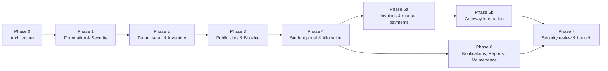

# Implementation Plan

> Status: Phase 0 draft, **awaiting explicit approval**. No phase after Phase 0 may start without written approval from the product owner.

## 1. Phase overview and dependencies

**Proposed adjustment to the brief's phases (needs approval):** split Phase 5 into **5a, invoices and manual/offline payments**, and **5b, gateway integration**.
- 5a has no external dependency.
- It lets the first hostel go live with MoMo-to-merchant-number and cash payments recorded by staff while gateway KYC/approval is pending, which can take weeks.
- 5b then adds online payment without blocking launch.

Phase 6 depends only on Phase 4, so it can overlap with 5b if you approve.

## 2. Phases, scope and acceptance criteria

### Phase 1: Foundation and Security
**Scope**
- Next.js (App Router, TS strict) scaffold in the repo root. Tailwind v4 + shadcn/ui themed with Modern Residence tokens. `next/font` DM Serif Display + Inter.
- Lint/format, Vitest, Playwright, Supabase CLI local project, pgTAP.
- Migrations for: extensions; schemas `app`/`private`; `tenants`, `tenant_domains`, `tenant_profiles`, `tenant_settings`, `user_profiles`, `platform_admins`, `permission_sets`, `tenant_memberships`, `residents`, `audit_logs`, `platform_access_grants`, `private.rate_limits`; RLS helper functions.
- Middleware host → tenant resolution; `getTenantContext`, `requirePermission`; service-role allow-list lint rule.
- Auth:
  - Staff email+password with TOTP MFA for admins; student email OTP code.
  - Sign-in, sign-out, password reset, MFA enrol screens.
- Audit logging helper + triggers.
- Base layouts: public tenant shell, staff shell, platform shell; 404/403/suspended pages.
- Seed script: 2 demo tenants, users for every role.
- `.env.example`; CI workflow (if a GitHub remote exists).

**Acceptance criteria**
1. `typecheck`, `lint`, `unit`, `pgTAP`, `e2e smoke` all pass locally, and the output is recorded in the checklist.
2. **Tenant-isolation tests:**
   - For every tenant-owned table created in Phase 1, a user of tenant A gets **0 rows** reading tenant B and is **denied** on insert/update/delete. This is tested through PostgREST with each role's JWT, not only via the app.
   - An anon user can read nothing private.
3. Spoofed `Host` and `x-tenant-id` headers do not change the resolved tenant for authenticated data.
4. Staff without `staff.manage` cannot create or alter memberships (pgTAP negative test); no user can elevate themselves; the last hostel admin cannot be removed.
5. Platform admin without MFA (aal1) is denied platform routes; with aal2 is allowed. Platform admin **cannot** read tenant residents without a break-glass grant; with a grant can read; the grant appears in the tenant audit log.
6. A CI check fails if any `public` table lacks RLS.
7. The client bundle contains no service-role key (automated grep check).
8. Lighthouse accessibility ≥ 95 on the sign-in page and public shell.

### Phase 2: Tenant setup and hostel administration
**Scope**
- Platform: create tenant wizard, first hostel admin invite, suspend/restore, domain add + Vercel verification status.
- Hostel admin:
  - Profile and branding (logo/photo upload with validation).
  - Booking periods; room types, photos, rooms, beds, bed blocks; pricing per period.
  - Staff invites and permission sets; operational settings.
- CSV import for rooms/beds (helps 50-bed onboarding).

**Acceptance criteria**
1. A platform admin can onboard a tenant end to end in under 10 minutes on staging: subdomain live, admin invited.
2. A hostel admin can model 50 beds (manually or via CSV) and see correct sellable-capacity counts per room type × period.
3. Brand colour input rejects colours failing 4.5:1 contrast.
4. Uploads reject non-image, SVG and >5 MB files, and strip EXIF (tests).
5. A suspended tenant's site shows the unavailable page, and staff are denied (tests).
6. Isolation and RBAC tests extended to all new tables; all pass.

### Phase 3: Public websites and booking
**Scope**
- Branded public site per tenant: home, room types list/detail, policies, contact.
- Availability indicator; period selection.
- Booking request flow with email OTP verification; reference generation; confirmation page and email (via the provisional email setup).
- Booking lookup.
- Staff review queue with approve/reject/waitlist; reservations with the hold timer, extension, and the expiry cron.

**Acceptance criteria**
1. A student can submit a request on a 360 px viewport with keyboard only and screen reader labels (Playwright + axe: 0 serious violations).
2. **Concurrency:** a test fires 20 parallel approvals for a room type with 1 remaining bed. Exactly 1 reservation is created and the other 19 fail with "no capacity".
3. Double-submit with the same idempotency key returns the same reference.
4. Holds expire within one cron interval of `hold_expires_at`, releasing capacity (integration test with a controlled clock).
5. Lookup returns status only, needs reference + email/phone, and is rate-limited (test).
6. Public pages LCP < 2.5 s on simulated slow 4G (Lighthouse mobile ≥ 85 performance) on seeded content.

### Phase 4: Student portal and bed allocation
**Scope**
- Student portal: overview timeline, booking details, profile & emergency contact, check-in info, announcements (read).
- Staff: bed map, assign/move/release bed, resident directory and profile.
- Check-in/check-out/no-show with checklist.

**Acceptance criteria**
1. **Concurrency:** 20 parallel `assign_bed` calls for the same bed and period produce exactly 1 allocation. A direct SQL insert bypassing the RPC is rejected by the exclusion constraint (test).
2. A move is atomic: no moment exists where the resident has 0 or 2 live allocations (test).
3. Blocking an occupied bed is refused; blocking a free bed reduces capacity (test).
4. A student sees only their own booking/bed/check-in data (IDOR tests with swapped IDs).
5. The check-in guard enforces the payment threshold (stubbed until 5a) and records an audit entry for overrides.

### Phase 5a: Invoices and manual payments
**Scope:** invoice generation on approval per deposit policy; invoice detail; manual payment recording with evidence; receipts (PDF or printable HTML); balances and overdue flags; refunds (record + four-eyes approval); finance views for the student.

**Acceptance criteria**
1. Invoice totals are immutable after issue; corrections only via void/adjustment (tests).
2. Recording a payment updates balance and status correctly across partial, full and over-payment cases (table-driven tests).
3. The reservation confirms automatically when the deposit threshold is met.
4. A refund cannot be approved by its requester, and total refunds cannot exceed the payment (tests).
5. Receipt numbers are unique and sequential per tenant under concurrent issuance (test).

### Phase 5b: Gateway integration (provider per D-6)
**Scope:** gateway configuration per tenant (Vault), MoMo-first checkout, server-side verify, webhook inbox, idempotent apply, reconciliation crons, mismatch handling, late-payment re-instatement.

**Acceptance criteria** (all in provider **test mode**, with recorded evidence):
1. Success via webhook; success with the browser closed (no callback visit); failure; abandonment.
2. Same webhook delivered 10× concurrently → exactly one credit.
3. Forged signature → 401 and no state change; valid signature but verify-API mismatch → `needs_review`.
4. Amount mismatch, currency mismatch and wrong-tenant reference each handled per BOOKING_AND_PAYMENT_FLOWS §5.
5. Payment after hold expiry → applied, and either re-instated or flagged.
6. Reconciliation detects a seeded unmatched provider transaction.
7. No secret appears in logs, the DB plain columns or the client bundle.

### Phase 6: Notifications, reports, operations
**Scope:** notification outbox + email templates (+ SMS if D-10); in-app notifications; maintenance management (admin board, assignment, bed blocking link); announcements; reports (occupancy, revenue, aged receivables, funnel); CSV export (audited); tenant audit-log viewer.

**Acceptance criteria**
1. Each notification is sent at most once per event (dedupe test) and retried with backoff on provider failure.
2. Report figures match seeded fixtures exactly.
3. Exports are permission-gated and produce an audit entry.
4. Maintenance internal notes are never visible to residents (test).

### Phase 7: Security review, acceptance testing, launch
**Scope:** full regression; isolation/RBAC suite; threat-model walk-through; dependency and secret audit; CSP enforce; accessibility audit (axe + manual keyboard/screen reader on core flows); responsive checks (360/768/1280); load test of booking/approval paths; restore drill; runbooks; staff training material; launch checklist.

**Acceptance criteria**
1. Zero open high/critical findings.
2. All prior phase criteria re-run green on staging with production configuration.
3. Restore drill completed with timings recorded.
4. Product owner signs off a UAT script executed by the first hostel's staff.

## 3. Task sizing rule
Each phase is broken into tasks of ≤ ~1 day / ≤ ~400 changed lines where practical. Each task has its own checklist entry with tests and results.

## 4. Testing strategy

| Layer | Tool | What |
|---|---|---|
| Unit | Vitest | Zod schemas, money/phone formatting, state-transition helpers, logger redaction, reference generator |
| Database | pgTAP via `supabase test db` | RLS isolation per table and role, RPC permission checks, transitions, constraints (exclusion, partial uniques), audit append-only |
| Integration | Vitest + local Supabase | Server actions with real JWTs per role; concurrency tests (parallel RPC calls); webhook handler with signed fixtures |
| E2E | Playwright (+ axe) | Booking flow, staff approval & allocation, student portal, payments (provider test mode in 5b), mobile viewport |
| Security | Custom tests + gitleaks + npm audit | Spoofed headers, IDOR swaps, forged webhooks, upload polyglots |
| Performance | Lighthouse CI on public pages; k6 or autocannon on booking RPCs (dev dependency only, approval needed) | |

Test data: deterministic seeds; no real student data in any non-production environment.

## 5. Key risks

| Risk | Impact | Likelihood | Mitigation |
|---|---|---|---|
| RLS mistake leaks cross-tenant data | Critical | Medium | RLS checklist, per-table pgTAP tests, CI RLS check, no service role in request paths |
| Gateway onboarding/KYC delays | High | High | Phase 5a manual payments lets launch proceed without the gateway |
| Payment edge cases (MoMo pending/timeouts) | High | Medium | Verify + reconciliation crons, monotonic state, test-mode scenario suite |
| Solo-developer bandwidth / scope creep | High | High | Strict phase gates, out-of-scope list, small tasks |
| Docker/Supabase CLI friction on Windows | Medium | Medium | Validate in Phase 1 day 1; fallback: a remote staging project for DB tests |
| Legal/data-protection obligations unknown | High | Medium | Legal review items listed; no claims until verified |
| Figma design file differs from Make export | Medium | Medium | Review the link before Phase 1 UI work; adjust the token/component plan |
| Peak-season load at admission time | Medium | Low | Static public pages, indexed queries, load test in Phase 7 |
| Email deliverability (OTP codes) | High | Medium | Production email provider with SPF/DKIM/DMARC before Phase 3 |
| Custom-domain DNS errors by hostels | Low | Medium | Subdomain always works; guided DNS instructions |

## 6. Decisions required from the product owner

| ID | Decision | Recommendation |
|---|---|---|
| D-1 | Platform brand name and root domain (Figma uses "ResidenceOS") | Choose before Phase 1 ends (needed for subdomains, email) |
| D-2 | Require email verification (OTP) before submitting a booking request | **Yes**: removes anonymous writes and spam, and gives the student portal access immediately |
| D-3 | Hold duration / extensions / confirmation threshold | 120 h default, 1 extension, deposit paid = confirmed |
| D-4 | Public availability display | Indicator (Available / Limited / Full + waitlist), not exact counts |
| D-5 | No-show rule | Staff may mark no-show 7 days after period start |
| D-6 | Payment gateway | **Paystack first** (see ADR-0004): mature docs, MoMo + cards, signed webhooks, verify API. Hubtel as alternative/second provider. Final choice after fees and settlement terms are confirmed with both for the first customer |
| D-7 | Cancellation & refund policy defaults | Tenant-configurable; default: full refund ≤ 48 h after payment and > 14 days before move-in, deposit retained after |
| D-8 | Merchant model | **Each hostel uses its own gateway merchant account** (platform never holds funds). Alternative (platform account + subaccounts/splits) only after legal review |
| D-9 | Transactional email provider | e.g. Resend or Postmark (new service, approval needed) |
| D-10 | SMS provider (Phase 6) | Ghana-local provider (e.g. Hubtel SMS, Arkesel, mNotify), compared on price, sender-ID registration and delivery reports |
| D-11 | Bot protection on public forms (Cloudflare Turnstile) | Optional; start with rate limits + OTP, add if abuse is seen |
| D-12 | PITR add-on and off-site backups | Enable PITR before first live payment |
| D-13 | Data retention periods | As proposed in SECURITY_THREAT_MODEL §7, pending legal review |
| D-14 | Collect gender / enforce gendered rooms | Only if the first hostel segregates by gender; optional per tenant |
| D-15 | Manual-payment evidence threshold and four-eyes refunds | Evidence required for all manual payments; refunds need a second approver |
| D-16 | Student access during tenant suspension | Read-only access to invoices/receipts |
| D-17 | Error monitoring (Sentry) | Optional; Vercel logs sufficient initially |
| D-18 | Git hosting (GitHub repo) for CI | Create a private GitHub repo before Phase 1 |
| D-19 | Phase 5 split into 5a/5b | Approve the split |
| D-20 | Admin on `app.` domain, student portal on tenant domain | Approve (ADR-0005) |

## 7. Information needed from the product owner
1. Figma design file link (view access) to compare with the Make export.
2. First customer: hostel name, bed/room layout (room types, rooms, beds), booking periods and prices, deposit/payment practice, current payment methods (MoMo merchant number? bank?), gender policy.
3. Whether the first hostel already has a Paystack or Hubtel merchant account.
4. Answers to D-1 … D-20.
