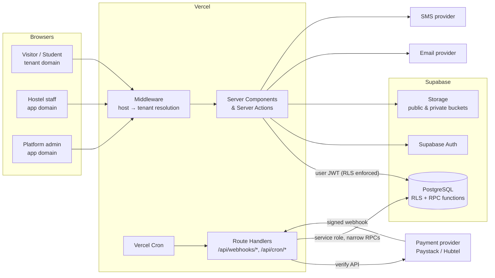

# System Architecture

> Status: Phase 0 draft, awaiting approval. Related ADRs: [0001](adr/0001-tenant-isolation.md) · [0002](adr/0002-authn-authz.md) · [0003](adr/0003-booking-concurrency.md) · [0004](adr/0004-payment-processing.md) · [0005](adr/0005-domain-resolution.md) · [0006](adr/0006-figma-reuse.md)

## 1. Overview

The system is one Next.js (App Router, TypeScript) application deployed on Vercel. It talks to one Supabase project (PostgreSQL, Auth, Storage). There are no microservices and no separate API server.



## 2. Surfaces and hosts

| Surface | Host | Audience | Rendering |
|---|---|---|---|
| Public hostel site | `{slug}.{platform-domain}` or a verified custom domain, e.g. `book.alderhouse.com.gh` | Visitors, applicants | Mostly static/ISR, revalidated on content change |
| Student portal | Same tenant host, under `/portal` | Students | Dynamic, authenticated |
| Hostel admin | `app.{platform-domain}/t/{tenantSlug}/…` | Hostel admins and staff | Dynamic, authenticated |
| Platform admin | `app.{platform-domain}/platform/…` | Super admins | Dynamic, authenticated, step-up MFA |

[R] Staff and platform admin live on one app domain, not on each tenant's custom domain, because:
- Staff from one company may manage several hostels (one login, with a tenant switcher).
- It avoids configuring Supabase Auth redirect URLs and cookies on every custom domain for privileged users.
- The admin surface stays off public brand domains, which shrinks its attack surface.

The student portal stays on the tenant domain so students see one branded experience. Students sign in with an email OTP code (typed in, no redirect link), so new custom domains need no Supabase redirect-URL changes. See [ADR-0005](adr/0005-domain-resolution.md).

## 3. Proposed source layout (Phase 1 will create this)

```
/app
  /(tenant)/[...]            public site + /portal (host-resolved tenant)
  /(app)/t/[tenantSlug]/...  staff workspace
  /(app)/platform/...        platform admin
  /api/webhooks/[provider]/[endpointId]/route.ts
  /api/cron/[job]/route.ts
/components/ui              shadcn/ui primitives, restyled to Modern Residence
/components/...             composed domain components
/lib/server/                 server-only modules ("server-only" import guard)
  tenant-context.ts          resolveTenantFromHost(), requireTenantMember()
  authz.ts                   requirePermission(ctx, 'bookings.approve')
  supabase/{server,admin}.ts admin.ts = service role, importable only by allow-listed modules
  payments/{paystack,hubtel}.ts
/lib/validation/             Zod schemas shared by forms and server actions
/supabase/migrations/        timestamped SQL migrations
/supabase/tests/             pgTAP RLS tests
/tests/{unit,integration,e2e}
/design-reference/figma-make Figma Make export (read-only reference, not built)
/docs
```

## 4. Request lifecycle and tenant context

```mermaid
sequenceDiagram
  participant B as Browser
  participant M as Middleware
  participant S as Server (RSC/Action)
  participant D as Postgres (RLS)
  B->>M: GET https://book.alderhouse.com.gh/rooms
  M->>M: strip any inbound x-tenant-* headers
  M->>M: lookup host in tenant_domains (edge cache, 60 s TTL)
  alt unknown / unverified / suspended
    M-->>B: 404 or "hostel unavailable" page
  else ok
    M->>S: forward with x-tenant-id set internally
  end
  S->>S: getTenantContext() re-validates host→tenant (cached per request)
  S->>D: query with user JWT; RLS checks membership/role
  D-->>S: rows for this tenant only
```

Rules:
1. **The tenant is resolved from the Host header on the server.** Any tenant ID in a URL, form field or header from the browser is treated as a selection to be checked, never as proof of access.
2. Staff routes include `tenantSlug` in the path. The server checks that the signed-in user has an active membership in that tenant (`requireTenantMember`) and the RLS policies check it again independently.
3. Every query runs with the **user's JWT** through `@supabase/ssr`, so RLS applies. The **service-role client** may only be imported by an allow-listed set of modules: payment webhooks, cron jobs, booking lookup, platform tenant provisioning, and the public-image upload module (after a permission check with the user's session). A lint rule plus a unit test enforce the list.
4. Server Actions validate every input with Zod, call `requirePermission`, and run multi-row state changes through **Postgres functions (RPCs)**, so each workflow step is one transaction.

## 5. Authentication vs authorization

- **Authentication** (who you are) is handled by Supabase Auth. Staff use email + password with TOTP MFA required for admins. Students use email OTP codes, with an optional password. Platform admins must use MFA (`aal2`).
- **Authorization** (what you can do in which tenant) lives in our own tables: `tenant_memberships` → `role` / permission set. It is enforced in two layers:
  - Server: `requirePermission()` gives fast failure and good error messages.
  - Database: RLS policies and `SECURITY DEFINER` RPCs that check `app.has_permission(tenant_id, perm)`. **The database is the final authority.** A bug in the server layer must not leak data.
- Permissions are **not** put in JWT custom claims in v1. A revoked membership must take effect on the next query, not when the token expires. If profiling shows a need, a cached `app.current_memberships()` can be added later.

## 6. Background and asynchronous work

| Job | Trigger | Mechanism |
|---|---|---|
| Expire stale holds | Every 15 min | Vercel Cron → `/api/cron/expire-holds` → RPC `expire_reservations()` |
| Payment reconciliation | Hourly, plus nightly full sweep | Cron → verify pending payments with the provider |
| Overdue invoice marking and reminders | Daily 08:00 Africa/Accra | Cron |
| Outbound notifications | On state change | `notification_outbox` table; cron drains it with retries (no extra queue service) |
| Domain verification polling | Every 30 min while pending | Cron → Vercel Domains API |

Cron frequency depends on the Vercel plan (Pro allows per-minute schedules). Each job is idempotent and safe to re-run. The cron routes require a `CRON_SECRET` bearer token.

## 7. Key trade-offs

### Shared database with RLS vs separate databases per tenant
| | Shared DB + `tenant_id` + RLS (chosen) | DB/schema per tenant |
|---|---|---|
| Cost | One Supabase project | One project per tenant: roughly $25+/month each, unaffordable for 50-bed hostels |
| Ops for a solo dev | One migration path | N migrations, N backups, N auth configs |
| Isolation strength | Logical; relies on correct RLS, so it needs tests | Physical |
| Cross-tenant analytics | Easy | Hard |
| Per-tenant export/restore | Needs scripted export by `tenant_id` | Trivial |

Shared DB is the right call at this scale. The risk is mitigated with RLS on every table, composite foreign keys, automated isolation tests, and no service-role use in request paths. Full reasoning in [ADR-0001](adr/0001-tenant-isolation.md).

### RLS vs server-side checks
Both are used. Server checks give UX and early rejection. RLS is the safety net that also protects against the Supabase anon key being used directly against PostgREST, which is always possible because that key is public.

### Server Actions + RPC vs a REST API layer
There are no external API consumers in v1, so Server Actions keep the code small. Workflows live in SQL functions, so a future REST/mobile API can reuse the same transactional logic.

## 8. Hosting cost and operational complexity (indicative, verify current pricing)
| Service | Plan | Why |
|---|---|---|
| Vercel | **Pro** (Hobby is for non-commercial use only) | Commercial use, custom domains via API, cron, team |
| Supabase | **Pro** | No auto-pause, daily backups, more email/auth limits; PITR add-on recommended before launch |
| Email | Transactional provider (e.g. Resend/Postmark) [D-9] | Supabase's built-in SMTP is not for production volume |
| SMS | Ghana provider (e.g. Hubtel SMS, Arkesel, mNotify) [D-10] | Phase 6 |
| Payment | Paystack or Hubtel [D-6] | Phase 5 |

## 9. Technology confirmation
Unchanged from the brief: Next.js App Router, TypeScript, React, Tailwind CSS (v4, matching the Figma export), shadcn/ui, Supabase (Postgres/Auth/Storage/RLS), Vercel, SQL migrations via Supabase CLI, Zod, Vitest, pgTAP, Playwright.

The only *additions* proposed are:
- Postgres extensions `btree_gist`, `citext` and `pgcrypto`, which Supabase includes. These are used for the bed-overlap exclusion constraint, case-insensitive email, and random references.
- A bot-protection widget on public forms (Cloudflare Turnstile) [D-11]. This is optional, needs approval, and is not CAPTCHA-solving.

Exact package versions are pinned in Phase 1 from what is current and stable at that time.
